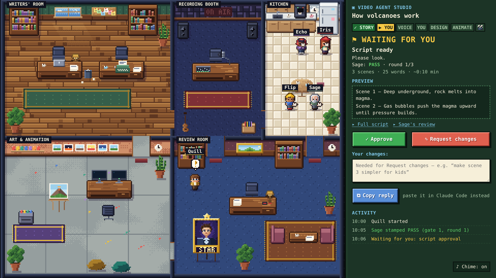
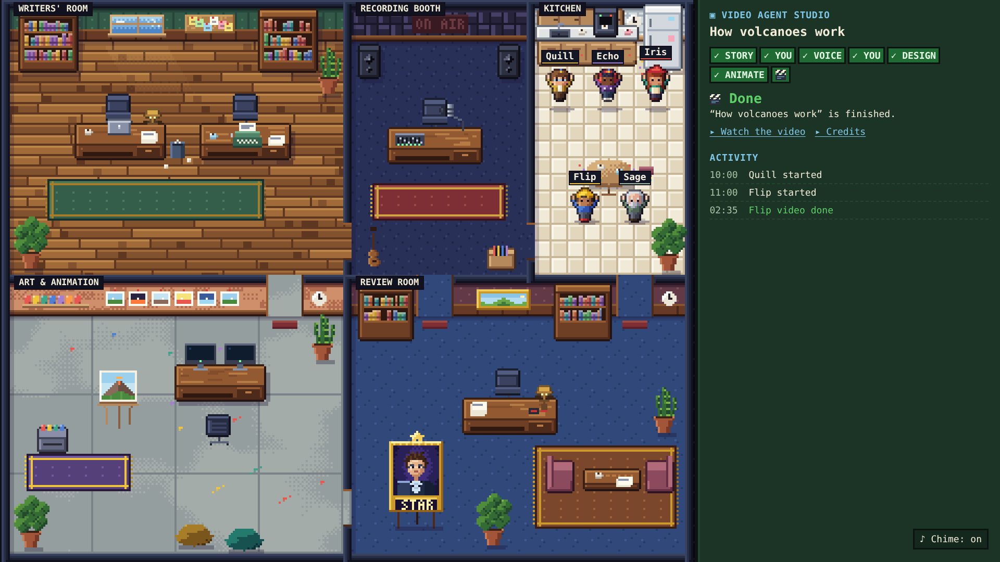
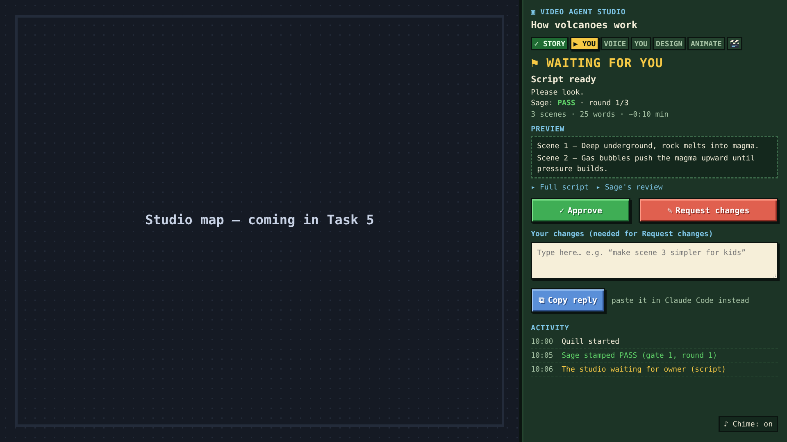

# The studio dashboard

A small web page that shows your video team at work, like a tiny animation studio, and lets you
approve their work with a button. It runs only on your PC. You do not need it to make videos:
the chat still works the same.



## How to open it

1. Open a **second** terminal (leave the one running Claude Code alone).
2. Run:

```
cd "C:\Users\PC\Documents\Claude Workspace"
.venv\Scripts\activate
python -m tools.dashboard
```

3. Your browser opens the studio by itself. If it does not, copy the link printed in the
   terminal (it starts with `http://127.0.0.1:`) into your browser.
4. Keep that terminal open while you make videos. Stop the studio with `Ctrl+C`.

Options (only if you need them): `--port 9000` (start looking at another port),
`--no-browser` (do not open the browser), `--root "<folder>"` (watch another project folder).

## What you see

**The map (left).** Four rooms and a kitchen: the Writers' Room (Quill), the Voice Booth
(Echo), the Art & Animation room (Iris and Flip) and the Review Room (Sage).

| Who | What it does when working |
|---|---|
| Quill (story) | Types at the desk. Throws crumpled paper into the bin when rewriting. |
| Echo (voice) | Talks into the microphone; the ON AIR light glows. |
| Iris (design) | Sketches at the easel; colour swatches pop up. |
| Flip (animator) | Flipbook frames flicker while the video renders. |
| Sage (reviewer) | Reads with a magnifier, then stamps PASS or FIX. |

What the movements mean:

- **Walking with papers**: work is handed over, for example the script goes to the Review Room.
- **Sage reading / stamping**: the work is being checked. A green PASS stamp means the gate passed.
- **Sage walking a FIX note back**: something must be changed; the agent gets back to work.
- **Someone standing by the Review Room door with a "!"**: the team is waiting for you.
- **Sage holding a red flag**: a gate failed 3 times and needs your decision.
- **Everyone celebrating**: the video is done. Then they go back to the kitchen.
- **Everyone in the kitchen**: no video is running.



**The board (right).** It shows the current step, the reviewer's notes and, when the team needs
you, a **WAITING FOR YOU** card with the script or the voice scenes (with Play buttons) and
these buttons:

- **Approve**: you are happy, the team goes on.
- **Request changes**: type what should change first, then press it.
- **Accept anyway / Give directions / Cancel**: shown when a gate got stuck after 3 rounds.
- **Send answer**: for a plain question from the team.

Press a button and it shows "Sent". Claude Code notices by itself within a few seconds and
carries on.



**Answered in chat.** If you answer in the Claude Code chat instead, the board notices and shows
"Answered in chat". Both ways work; the first answer wins.

**Copy reply.** Under each question there is a **Copy reply** button. It copies the answer you
chose, so you can paste it into the chat if you prefer to answer there.

**Chime.** At the bottom is a button "Chime: on / off". When on, the page plays a soft sound
(and a browser notification, if you allow it) when the team needs you. Press it to turn it off.

When nothing is running the board says "No video running". Start one with `/make-video` in
Claude Code.

## Rename the agents

Open `team.json` in the project folder with Notepad. Each person has a `name` and a `look`.
Change only the text inside the quotes on the right, keep all quotes, commas and brackets.
Example: rename Quill to Maya:

```
{"story":{"name":"Maya","look":"round glasses, cardigan, coffee mug"},
 "voice":{"name":"Echo","look":"big headphones, hoodie"},
 "design":{"name":"Iris","look":"beret, paint palette"},
 "animator":{"name":"Flip","look":"backwards cap, drawing tablet"},
 "reviewer":{"name":"Sage","look":"older, grey beard, clipboard"}}
```

Save, then refresh the browser page. The new name shows on the map and the board. `/make-video`
reads the names when it starts, so it uses them in its next run. The names are only labels:
renaming can never break the video pipeline. If you make a typing mistake in the file, the
studio falls back to the default names.

## Privacy and security

- The studio runs only on your PC and only answers to your PC (`127.0.0.1`). Nothing goes online.
- Each time you start it, it makes a secret key and puts it in the link. Only that link can send
  an approval, so no other web page can approve things for you.
- It only reads your `videos` folder and writes your answers there. No account, no tracking.

## Troubleshooting

- **"Port busy" / it starts on another number.** Nothing to fix: it tries the next ports by itself
  (8766, 8767 ...). Use the link it prints.
- **"No free port in 8765-8775".** Eleven studios (or other programs) already hold those ports.
  Close the other studio windows (terminals running `python -m tools.dashboard`), or start it
  on another range with `python -m tools.dashboard --port 9000`.
- **Start it from the right folder.** The studio must be started from the same project folder
  Claude Code runs in; otherwise it looks at a different `videos` folder and never sees your run.
- **"Studio key missing".** You opened the page without its key. Close the tab and open the link
  printed in the terminal again (the whole link, including `?key=...`). The key changes every
  time you start the studio, so old bookmarks stop working.
- **The board shows nothing / "No video running".** Check that `/make-video` is really running
  in Claude Code, and that the studio was started from the same project folder as Claude Code
  (the `cd` line above). Then wait a couple of seconds, or refresh.
- **Pressed Approve but Claude Code does not move.** Wait about 10 seconds. If nothing happens,
  answer in the chat; the answer is never lost.
- **Nothing happens at all.** Check the terminal running the studio for a red message and copy
  it to Claude Code.

## Checked so far

The "Claude Code wakes up by itself after a board answer" step was tested and works in a cloud
session. It still has to be confirmed on your Windows PC: see item 2 in section "The studio
dashboard" of `docs\TEST-CHECKLIST.md`.
